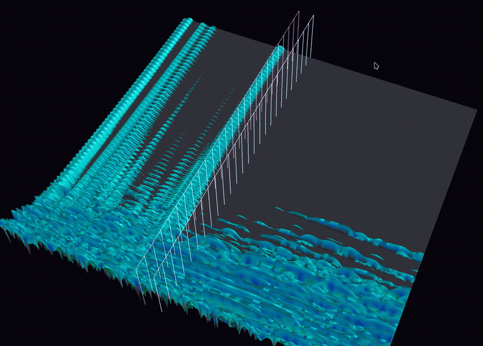

# Xorcist

It casts out the xruns.

Deadline-miss concealment for real-time audio: when a period's mix is
not finished in time, Xorcist synthesizes a spectral continuation of
the signal and plays that instead of a dropout, rather than falling
back to silence. See the header-level design comment in `xorcist.h`
for the DSP approach, and
[`docs/disclosures/xorcist-concealment-technical-disclosure.md`](../../docs/disclosures/xorcist-concealment-technical-disclosure.md)
(in the host repository this library was extracted from) for a full,
host-independent technical disclosure of the technique, including its
measured results and limitations.



**Status:** extracted from, and still developed alongside, its host
application ([GrandOrgue](https://github.com/GrandOrgue/grandorgue)'s
`GOSoundConcealment`); this is the same implementation that runs there,
not a reimplementation. Treat it as a working library with an actively
evolving tuning surface (see `XorcistTuning` in `xorcist.h`), not yet a
stable, versioned public API.

## Building

Dependencies: a single-precision FFTW3 (`fftw3f`); an OpenCL ICD loader
and headers are optional (the per-bin solve step can offload to a GPU
when available, with automatic, silent fallback to CPU-only operation
otherwise — see `XorcistTuning.gpu` in `xorcist.h`).

As a standalone CMake project:

```sh
mkdir build && cd build
cmake ..
make
```

Produces a shared library by default (`XORCIST_SHARED`, `ON` unless
overridden); pass `-DXORCIST_SHARED=OFF` for a static build, as its
host application does (`XORCIST_LIBRARY_TYPE STATIC` in the host's
build). `xorcist_kernels.cl` is valid OpenCL C and also compiles as
plain C99 with `XO_HOST_C` defined (see its own header comment) — it is
the one text shared, bit-identically, between the CPU and GPU solve
paths.

## Minimal usage

```c
#include "xorcist.h"

Xorcist *x = Xorcist_new(channels, framesPerPeriod, sampleRate, NULL);

/* Every period, regardless of whether this period will miss its
 * deadline — the continuation must already exist, finished, by the
 * time a miss is known: */
Xorcist_push(x, interleaved_output_of_this_period);
Xorcist_predict(x);

/* ...and only if this period actually missed its deadline: */
float concealed[channels * framesPerPeriod];
if (Xorcist_conceal(x, concealed)) {
  /* play `concealed` instead of a dropout */
}

Xorcist_free(x);
```

See `xorcist.h` for the complete API (the split `Xorcist_predictBegin`
/ `Xorcist_predictChannel` / `Xorcist_predictEnd` form for hosts with
spare worker threads, `Xorcist_pushMany`/`Xorcist_replaceLast` for
buffering edge cases, `Xorcist_peek`/`Xorcist_horizonFrames` for
inspecting a pending prediction without consuming it, and the
`Xorcist_*Stats`/`Xorcist_setProfiling` family for instrumentation) —
every public function and the full `XorcistTuning` struct are
documented there directly.

## Tests and reproducing the measured results

- `tools/concealment/schur_test.c`, `schur_rho_test.c` (in the host
  repository) — unit tests for the per-bin stability test described in
  the technical disclosure's part 1.
- `tools/concealment/gap_lab.py` — the measurement harness behind the
  technical disclosure's "Measured results" section, including the
  NMR perceptual-error metric's actual implementation
  (`audibility_metric`/`concealment_metrics`); see its own module
  docstring and the technical disclosure's NMR definition for how to
  read its output.
- `tools/concealment/track_bench.c`, `clbench.c` — timing/GPU-offload
  benchmarks.

These currently live alongside the host application, not in this
directory, because they were developed against it; see the technical
disclosure for the host-independent description of what they measure.

## Dependencies and their licenses

- FFTW3 (`fftw3f`) — GPL-2.0-or-later (or a separate commercial license
  from its authors; see fftw.org).
- OpenCL headers/ICD loader (optional, build-time only) — various
  permissive licenses depending on vendor; not bundled here.

## License

Dual-licensed: the GNU General Public License v3.0 or later (see
`LICENSE`, the canonical GPLv3 text), or a separate commercial license
for proprietary use without the GPL's obligations — contact
**sebion7125@gmail.com**.

Copyright (C) 2026 **Sebion7125**.
